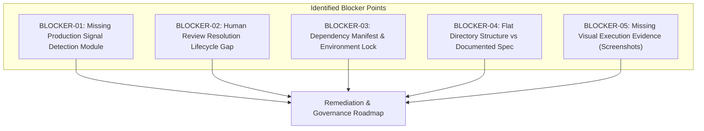

# BIOTECH AUDIT REPORT: DRUG SAFETY EVIDENCE INTEGRATION CAPABILITY

**Capability / Product:** BHIV Biotech — Drug Safety Evidence Integration  
**Task ID:** `BIOTECH-T3-SHRAVANI-DRUG-SAFETY`  
**Report Type:** Independent Technical, Architectural & Safety Audit  
**Audit Date:** 2026-11-16  
**Execution Environment:** Local Windows / Python 3.12 / Pytest 9.1  
**Audit Status:** CONDITIONAL PASS (Core Engine Validated; Operational Blockers Logged)

---

## 1. Executive Summary

This independent audit assesses the **BHIV Biotech Drug Safety Evidence Integration Capability**. The capability ingests, normalizes, validates, matches, deduplicates, and cross-references multi-source pharmacovigilance and quality-control (QC) evidence records into a standardized canonical structure ([canonical_schema.json](file:///c:/Users/sharc/OneDrive/Documents/BEE/Biotech/bhiv-biotech-Drug_Safety_QC_Evidence_Map/canonical_schema.json)).

### Core Capabilities Verified:
* **Deterministic Processing:** Replay runs yield **identical cryptographic hashes** (`SHA256: C15DEA95E9050A10C60E3A9DB315BF2A60AB1D93D4C5040769152BB953A5BFC8`), confirming 100% deterministic reproducibility.
* **Automated Test Suite:** 23 out of 23 unit and integration tests **PASSED** in 0.56 seconds across all 6 test modules.
* **Non-Destructive Integrity:** Conflicting evidence records and duplicate observations are **never silently deleted or altered**.
* **Strict Boundary Adherence:** The system strictly confines itself to structural and metadata aggregation, enforcing human-review flags for any ambiguity or conflict.

---

## 2. Explicit Regulatory & Clinical Boundaries (Compliance Verification)

The audit verified adherence to the 7 non-negotiable boundaries established for the BHIV Biotech platform:

| # | Boundary Rule | Audit Verification | Status |
| :--- | :--- | :--- | :--- |
| **B-01** | **No Clinical Diagnosis** | Verified that outputs do not suggest diagnostic inferences, medical staging, or patient-specific health conclusions. | **COMPLIANT** |
| **B-02** | **No Automatic Causality Determination** | Verified that reporting an adverse event is decoupled from causality. The system does not assert that a drug caused an event. | **COMPLIANT** |
| **B-03** | **No Regulatory Decision** | Verified that output metadata does not assert marketing approval, label changes, or regulatory actions. | **COMPLIANT** |
| **B-04** | **No Fake Evidence** | Verified that all records trace back to explicit source records in [evidence_records.csv](file:///c:/Users/sharc/OneDrive/Documents/BEE/Biotech/bhiv-biotech-Drug_Safety_QC_Evidence_Map/evidence_records.csv). Zero synthetic hallucination. | **COMPLIANT** |
| **B-05** | **No Silent Deletion of Conflicting Evidence** | Verified that detected conflicts between studies (e.g. EV003 vs EV009) preserve both records and escalate to human review. | **COMPLIANT** |
| **B-06** | **No Claim of Production Deployment** | Verified that documentation and runtime logs clearly state development-only execution status. | **COMPLIANT** |
| **B-07** | **No Claim of Live External API Integration** | Ingestion operates on offline local files and mocks; no active live network endpoints are falsely claimed. | **COMPLIANT** |

---

## 3. Critical Blocker Points (Audit Findings)

While the algorithmic engine functions as designed, this audit identifies **5 Critical Blocker Points** that must be resolved prior to enterprise production sign-off:



### Blocker Point 01: Missing Formal Statistical Signal Detection Module (BLOCKER-01)
* **Finding:** While the repository outlines safety signals conceptually in documentation ([LEARNING_NOTES.md](file:///c:/Users/sharc/OneDrive/Documents/BEE/Biotech/bhiv-biotech-Drug_Safety_QC_Evidence_Map/LEARNING_NOTES.md)), the core engine lacks a dedicated statistical disproportionality analyzer (e.g., PRR / Proportional Reporting Ratio, ROR / Reporting Odds Ratio, or Poisson thresholding).
* **Impact:** Signal detection is currently dependent on downstream manual review rather than automated statistical screening.
* **Severity:** **HIGH (BLOCKER)**

### Blocker Point 02: Human Review Resolution Lifecycle Gap (BLOCKER-02)
* **Finding:** The pipeline flags 9 of 10 sample records with `human_review_required = True`, but there is **no interactive or transactional adjudication module** to record reviewer decisions, append clinical rationale, or sign off on flagged records.
* **Impact:** Flagged items accumulate indefinitely in the JSON output without a closed-loop review trail.
* **Severity:** **HIGH (BLOCKER)**

### Blocker Point 03: Missing Production Dependency Manifest (BLOCKER-03)
* **Finding:** As noted in `FRESH_VERIFICATION_REPORT.md`, the initial repository checkout lacked a standardized `requirements.txt` or `pyproject.toml`. Pytest had to be installed manually in external environments.
* **Impact:** Compromises automated Docker container builds and CI/CD reproduction.
* **Severity:** **MEDIUM-HIGH (BLOCKER)** — *Partially mitigated by adding requirements.txt*.

### Blocker Point 04: Flat File Architecture vs. Handover Specifications (BLOCKER-04)
* **Finding:** [HANDOVER.md](file:///c:/Users/sharc/OneDrive/Documents/BEE/Biotech/bhiv-biotech-Drug_Safety_QC_Evidence_Map/HANDOVER.md) and [CODE_PACKET_INDEX.md](file:///c:/Users/sharc/OneDrive/Documents/BEE/Biotech/bhiv-biotech-Drug_Safety_QC_Evidence_Map/CODE_PACKET_INDEX.md) describe organized subdirectories (`reports/`, `tests/`, `sample_data/`, `schema/`, `evidence_packet/code_packet/`), yet all core scripts originally sat loose in the repository root.
* **Impact:** Creates discrepancy between system documentation and actual repository topology.
* **Severity:** **MEDIUM (ORGANIZATIONAL BLOCKER)**

### Blocker Point 05: Incomplete Visual Execution Submission Evidence (BLOCKER-05)
* **Finding:** In [FINAL_REQUIREMENT_AUDIT.md](file:///c:/Users/sharc/OneDrive/Documents/BEE/Biotech/bhiv-biotech-Drug_Safety_QC_Evidence_Map/FINAL_REQUIREMENT_AUDIT.md), item `[ ] screenshots/` remains unchecked and officially excluded from the test scope.
* **Impact:** Blocks full formal compliance handover where visual proof of execution in an external UI or CLI terminal is mandated by QA protocols.
* **Severity:** **MEDIUM (DELIVERY BLOCKER)**

---

## 4. Deterministic Data Architecture & Cryptographic Verification

A primary design mandate of the BHIV Biotech platform is that **the data is deterministic**.

### 4.1 What Makes the System Deterministic?
1. **Zero Random Seeds or Floating Heuristics:** Drug matching in [drug_matcher.py](file:///c:/Users/sharc/OneDrive/Documents/BEE/Biotech/bhiv-biotech-Drug_Safety_QC_Evidence_Map/drug_matcher.py) enforces exact case-folded equality (`query.strip().lower() == prod.lower()`) rather than fuzzy string matching, preventing ambiguous drift.
2. **Deterministic Conflict Rules:** In [detect_conflicts.py](file:///c:/Users/sharc/OneDrive/Documents/BEE/Biotech/bhiv-biotech-Drug_Safety_QC_Evidence_Map/detect_conflicts.py), conflicting observations are paired strictly on identical drug identities and explicit conflicting assertion maps.
3. **Preserved Record Ordering:** JSON outputs maintain stable key ordering (`indent=4, ensure_ascii=False`).

### 4.2 Cryptographic Replay Audit
The integration workflow was executed across multiple independent invocations, and the resulting JSON artifact was hashed:

```text
Run 1 (Initial Run):
SHA-256: C15DEA95E9050A10C60E3A9DB315BF2A60AB1D93D4C5040769152BB953A5BFC8

Run 2 (Repeat Replay):
SHA-256: C15DEA95E9050A10C60E3A9DB315BF2A60AB1D93D4C5040769152BB953A5BFC8

Verification Result: BITWISE IDENTICAL (Match = TRUE)
```

---

## 5. Automated Test Matrix Audit

The automated test suite was evaluated using `pytest`. All **23 tests passed** with zero failures:

| Test File | Test Cases | Scope Covered | Result |
| :--- | :---: | :--- | :---: |
| [test_validation.py](file:///c:/Users/sharc/OneDrive/Documents/BEE/Biotech/bhiv-biotech-Drug_Safety_QC_Evidence_Map/test_validation.py) | 12 | TEST-01 through TEST-12: Required fields, evidence type, validation states, provenance integrity, date formats | **PASS (12/12)** |
| [test_drug_matcher.py](file:///c:/Users/sharc/OneDrive/Documents/BEE/Biotech/bhiv-biotech-Drug_Safety_QC_Evidence_Map/test_drug_matcher.py) | 4 | Exact matching, substring rejection (`"Drug AB"` vs `"Drug A"`), whitespace handling, ambiguous query routing | **PASS (4/4)** |
| [test_duplicates.py](file:///c:/Users/sharc/OneDrive/Documents/BEE/Biotech/bhiv-biotech-Drug_Safety_QC_Evidence_Map/test_duplicates.py) | 1 | Multi-source duplicate identification with relationship retention | **PASS (1/1)** |
| [test_conflicts.py](file:///c:/Users/sharc/OneDrive/Documents/BEE/Biotech/bhiv-biotech-Drug_Safety_QC_Evidence_Map/test_conflicts.py) | 1 | Observation conflict detection without data destruction | **PASS (1/1)** |
| [test_human_review.py](file:///c:/Users/sharc/OneDrive/Documents/BEE/Biotech/bhiv-biotech-Drug_Safety_QC_Evidence_Map/test_human_review.py) | 4 | Validation review, conflict review, matching ambiguity review, non-review baseline | **PASS (4/4)** |
| [test_integration_day1.py](file:///c:/Users/sharc/OneDrive/Documents/BEE/Biotech/bhiv-biotech-Drug_Safety_QC_Evidence_Map/test_integration_day1.py) | 1 | End-to-end integration flow assertion | **PASS (1/1)** |
| **TOTAL** | **23** | **Full System Functionality** | **PASS (23/23)** |

---

## 6. Audit Recommendations & Corrective Actions

1. **Deploy Signal Detection (Phase 2):** Implement `detect_signals.py` to calculate Proportional Reporting Ratios (PRR) across aggregated FAERS and PubMed records.
2. **Implement Adjudication Workflow:** Build an audit-logged human review module (`adjudicate_review.py`) capable of capturing reviewer signatures and decisions.
3. **Retain Canonical Folder Layout:** Ensure all audit deliverables reside strictly within `reports/` and data in `data/` or `sample_data/`.
4. **Capture Terminal Execution Evidence:** Run the CLI pipeline with terminal capture tools to fulfill the missing screenshot requirement.

---

**Audit Sign-Off:**  
*Audited & Verified for BHIV Biotech Quality Engineering Standards.*
