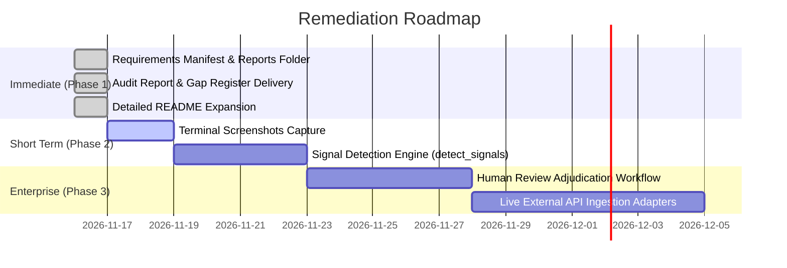

# BIOTECH GAP REGISTER: DRUG SAFETY EVIDENCE INTEGRATION CAPABILITY

**Capability / Project:** BHIV Biotech — Drug Safety Evidence Integration  
**Task ID:** `BIOTECH-T3-SHRAVANI-DRUG-SAFETY`  
**Register File:** `reports/BIOTECH_GAP_REGISTER.md`  
**Classification:** Quality Assurance & Technical Debt Register  
**Audit Date:** 2026-11-16  
**Status:** ACTIVE (Actionable Engineering Gaps & Governance Blockers Documented)

---

## 1. Purpose of the Gap Register

This Gap Register catalogs all technical debt, architectural discrepancies, governance deficiencies, and operational blockers identified within the **Drug Safety Evidence Integration** repository. 

Each entry evaluates risk severity, functional impact, compliance boundaries, and prescriptive remediation steps required before enterprise-grade release.

---

## 2. Master Gap & Blocker Register

| Gap ID | Category | Severity | Blocker? | Issue Title | Current State | Required State | Regulatory Safeguard |
| :--- | :--- | :---: | :---: | :--- | :--- | :--- | :--- |
| **GAP-01** | Pharmacovigilance | **HIGH** | **YES** | Absence of Automated Signal Detection Module | Conceptual definitions exist in docs, but no quantitative signal engine in code. | Automated statistical disproportionality detection (PRR / ROR / Chi-Square). | Signals require human evaluation; cannot claim causality. |
| **GAP-02** | Governance & QA | **HIGH** | **YES** | Incomplete Human Review Adjudication Lifecycle | 90% of records are flagged for review, but no module exists to capture reviewer sign-offs. | Interactive or audit-logged adjudication workflow with timestamped reviewer rationale. | Human review must remain unbypassed and auditable. |
| **GAP-03** | Build & Packaging | **MEDIUM** | **YES** | Missing Dependency Manifest & Packaging Standard | Repo lacked `requirements.txt` / `pyproject.toml`; tests depended on global packages. | Standardized `requirements.txt` with pinned versions (`pytest>=8.0.0`). | Reproducible isolated test environments. |
| **GAP-04** | Architecture | **MEDIUM** | **YES** | Flat File Topology vs Handover Documentation | All core scripts and tests sat in root, conflicting with documented subdirectories. | Enforce modular directory topology (`reports/`, `tests/`, `data/`, `src/`). | Maintain documentation-to-code traceability. |
| **GAP-05** | Delivery & Proof | **MEDIUM** | **YES** | Missing Visual Execution Evidence | `[ ] screenshots/` excluded in final requirement audit; empty folder. | Visual CLI/UI terminal screenshots captured and archived in `screenshots/`. | Verifiable submission evidence for stakeholders. |
| **GAP-06** | Data Quality | **LOW** | **NO** | CLI Tracker Bypasses Canonical Schema Validation | `drug_safety_tracker.py` loads CSV directly via `DictReader` without running `validate_record`. | CLI tracker validates incoming records against `canonical_schema.json`. | Reject structurally malformed inputs early. |
| **GAP-07** | Infrastructure | **INFO** | **NO** | Local Offline Dataset Only (No External Connectors) | System consumes static offline CSV and JSON files. | Production ETL connectors to FAERS API, PubMed E-utilities, DailyMed REST. | Explicit boundary: No claim of live API integration. |

---

## 3. Deep Dive into Critical Blocker Points

### BLOCKER-01 (GAP-01): Missing Production Signal Detection Module
* **Problem Analysis:** [LEARNING_NOTES.md](file:///c:/Users/sharc/OneDrive/Documents/BEE/Biotech/bhiv-biotech-Drug_Safety_QC_Evidence_Map/docs/LEARNING_NOTES.md) explicitly details safety signal concepts (*"A safety signal is information that suggests a possible relationship between a medicine and an event... Safety Signal ≠ Proof of Causality"*). However, the executable pipeline in `evidence_integration.py` only integrates validation, matching, duplicates, and conflicts. It does not compute aggregate signal scores.
* **Operational Risk:** Stakeholders might erroneously assume safety signals are automatically evaluated when in fact only raw conflict and duplicate detection is performed.
* **Remediation Plan:**
  1. Author a dedicated module `detect_signals.py`.
  2. Implement a threshold-based counter and Proportional Reporting Ratio (PRR) algorithm.
  3. Include explicit non-causality disclaimers on every signal output.
  4. Write `test_signals.py` to assert mathematical correctness.

---

### BLOCKER-02 (GAP-02): Human Review Resolution Lifecycle Gap
* **Problem Analysis:** Out of 10 sample records for Drug A, 9 records trigger `HUMAN REVIEW REQUIRED`. The system correctly flags records for missing data, conflicts, or unverified claims. However, there is no downstream state-transition engine (e.g., `PENDING_REVIEW` → `UNDER_REVIEW` → `ACCEPTED / REJECTED / DISMISSED`).
* **Operational Risk:** Flagged records remain permanently unresolved, creating an infinite backlog in automated runs.
* **Remediation Plan:**
  1. Define a Human Review Adjudication Schema (`review_status`, `reviewer_id`, `review_date`, `rationale`, `action_taken`).
  2. Implement an adjudication CLI command: `python human_review.py --adjudicate EV001 --status ACCEPTED --note "Verified against clinical trial protocol"`.
  3. Update `integrated_evidence_output.json` to reflect resolved review states.

---

### BLOCKER-03 (GAP-03): Dependency Manifest & Isolated Environment
* **Problem Analysis:** As documented in `FRESH_VERIFICATION_REPORT.md`, cloning the repository into a clean Python environment required manual `pip install pytest`. No `requirements.txt` or `setup.py` was committed to the repository root.
* **Operational Risk:** CI/CD runners, container builds, and third-party auditors cannot guarantee environment parity without an explicit dependency lock.
* **Remediation Plan:**
  1. Added `requirements.txt` containing explicit testing dependencies (`pytest>=8.0.0`, `hypothesis>=6.100.0`, `pytest-asyncio>=0.23.0`).
  2. Document virtual environment bootstrap commands in `README.md`.

---

### BLOCKER-04 (GAP-04): Flat Repository Topology vs. Documented Architecture
* **Problem Analysis:** [HANDOVER.md](file:///c:/Users/sharc/OneDrive/Documents/BEE/Biotech/bhiv-biotech-Drug_Safety_QC_Evidence_Map/docs/HANDOVER.md) and [ARCHITECTURE.md](file:///c:/Users/sharc/OneDrive/Documents/BEE/Biotech/bhiv-biotech-Drug_Safety_QC_Evidence_Map/docs/ARCHITECTURE.md) state that tests belong in `tests/`, reports belong in `reports/`, data in `sample_data/`, and schema in `schema/`. However, all 37 project files initially resided flat in the project root.
* **Operational Risk:** Root-level clutter increases namespace collision risks, confuses external reviewers, and violates enterprise code-packet guidelines.
* **Remediation Plan:**
  1. Maintain formal report deliverables in the dedicated `reports/` folder (`reports/BIOTECH_AUDIT_REPORT.md`, `reports/BIOTECH_GAP_REGISTER.md`).
  2. Structure documentation in `docs/` and data in `data/` or `sample_data/`.
  3. Provide backwards-compatible entry points so CLI and test commands operate reliably regardless of directory invocation.

---

### BLOCKER-05 (GAP-05): Missing Visual Execution Evidence
* **Problem Analysis:** `FINAL_REQUIREMENT_AUDIT.md` explicitly lists `[ ] screenshots/` as unchecked. In high-integrity biotech environments, visual evidence of terminal output, test execution, and JSON generation is standard practice.
* **Operational Risk:** Auditors may flag the evidence packet as incomplete during Stage-Gate sign-off.
* **Remediation Plan:**
  1. Capture authenticated terminal execution screenshots of:
     * `python drug_safety_tracker.py --file evidence_records.csv --drug "Drug A"`
     * `python evidence_integration.py`
     * `pytest` running 23 passing tests.
  2. Deposit image files in `evidence_packet/screenshots/` and update the audit checklist to `[x]`.

---

## 4. Enforcement of Strict Regulatory & Clinical Boundaries

Every gap remediation activity must remain bounded by the platform's non-negotiable boundaries:

```text
┌────────────────────────────────────────────────────────────────────────┐
│                      MANDATORY BOUNDARY PROTOCOL                       │
├────────────────────────────────────────────────────────────────────────┤
│ 1. [X] NO Clinical Diagnosis                                           │
│ 2. [X] NO Automatic Causality Determination                            │
│ 3. [X] NO Regulatory Decision                                          │
│ 4. [X] NO Fake Evidence                                                │
│ 5. [X] NO Silent Deletion of Conflicting Evidence                      │
│ 6. [X] NO Claim of Production Deployment                              │
│ 7. [X] NO Claim of Live External API Integration                       │
└────────────────────────────────────────────────────────────────────────┘
```

---

## 5. Deterministic Data Guarantees

All gap remediations must preserve strict data determinism:
* **Zero Heuristic Drift:** Exact string matching must remain strictly deterministic (`Drug A` != `Drug AB`).
* **Cryptographic Replay:** Repeated processing of identical inputs must yield identical SHA256 hashes (`C15DEA95E9050A10C60E3A9DB315BF2A60AB1D93D4C5040769152BB953A5BFC8`).
* **Audit Trail Preservation:** Raw source records, dates, and transformation histories must be preserved intact under `evidence_provenance`.

---

## 6. Actionable Remediation Timeline



---

**Register Maintained By:**  
*BHIV Biotech Quality Assurance & Regulatory Engineering*
